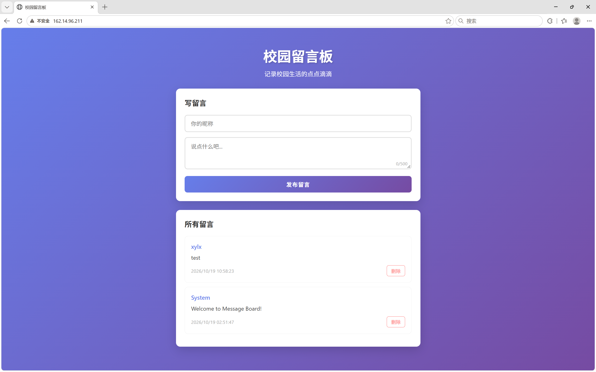
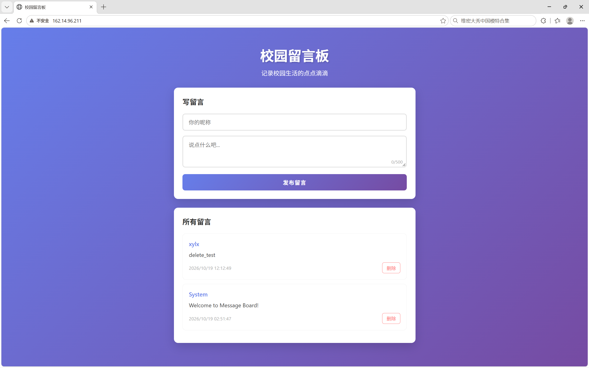
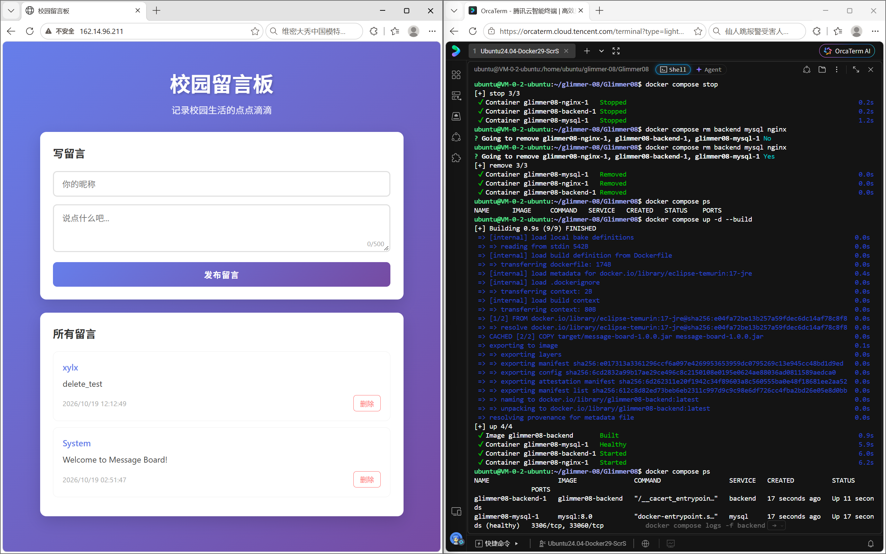

# 微光2026招新-Web后端-08

- **仓库链接：**https://github.com/xylx-etto/glimmer-08/

- **公网访问地址以及访问成功的截图**

  http://162.14.96.211/

  - **发布新留言**

  

  - **删除留言**（可根据时间推断）
  - **销毁容器重开**

- **修改说明**

  - backend/Dockerfile

    ```dockerfile
    FROM eclipse-temurin:17-jre 
    #基于Java 17基础镜像（openjdk17好像无了）
    COPY target/message-board-1.0.0.jar message-board-1.0.0.jar
    #打包jar包
    CMD ["java", "-jar", "message-board-1.0.0.jar"]
    #启动配置
    ```

  - docker-compose.yml

    ```yaml
    services:
      backend:								
        build: ./backend					#根据Dockerfile构建容器
        environment:						#配置环境变量
          MYSQL_HOST: mysql
          MYSQL_PORT:  "3306"
          MYSQL_DATABASE: message_board
          MYSQL_USER: root
          MYSQL_PASSWORD: "123456"
        depends_on:							#配置依赖，在mysql检查健康后再启用后端
          mysql:
            condition: service_healthy
    
      nginx:
        image: nginx:alpine					#拉nginx镜像
        ports:
          - "80:80"							#宿主机端口80映射容器端口80
        volumes:							#挂载：宿主机路径:容器内路径:权限
          - ./nginx/nginx.conf:/etc/nginx/conf.d/default.conf:ro
          - ./frontend:/usr/share/nginx/html:ro
        depends_on:							#后端启动后再启动
          - backend
    
      mysql:
        image: mysql:8.0					#拉取镜像
        environment:
          - MYSQL_ROOT_PASSWORD=123456
        volumes:						
          - mysql-data:/var/lib/mysql		#数据永久化
          - ./sql/init.sql:/docker-entrypoint-initdb.d/init.sql:ro  #宿主机路径:容器内路径:权限
        healthcheck:						#健康检查，ping不超时就健康
          test: ["CMD", "mysqladmin", "ping", "-h", "127.0.0.1"]
          interval: 10s
          timeout: 5s
          retries: 10
          start_period: 30s
    
    volumes:								#声明
      mysql-data:
    ```

  - nginx.conf

    ```nginx
    server {
        listen       80;
        listen  [::]:80;
        server_name  localhost;
        location / {
            root   /usr/share/nginx/html;					#根路径指向前端静态页面
            index  index.html index.htm;					
        }
        error_page   500 502 503 504  /50x.html;
        location = /50x.html {
            root   /usr/share/nginx/html;
        }
        location /api/ {									#反向代理配置
            proxy_pass http://backend:8080;					#api请求转到后端8080端口
            proxy_set_header Host $host;					#请求头转交访问用户信息
            proxy_set_header X-Real-IP $remote_addr;
            proxy_set_header X-Forwarded-For $proxy_add_x_forwarded_for;
            proxy_set_header X-Forwarded-Proto $scheme;
        }
    }
    ```

    

